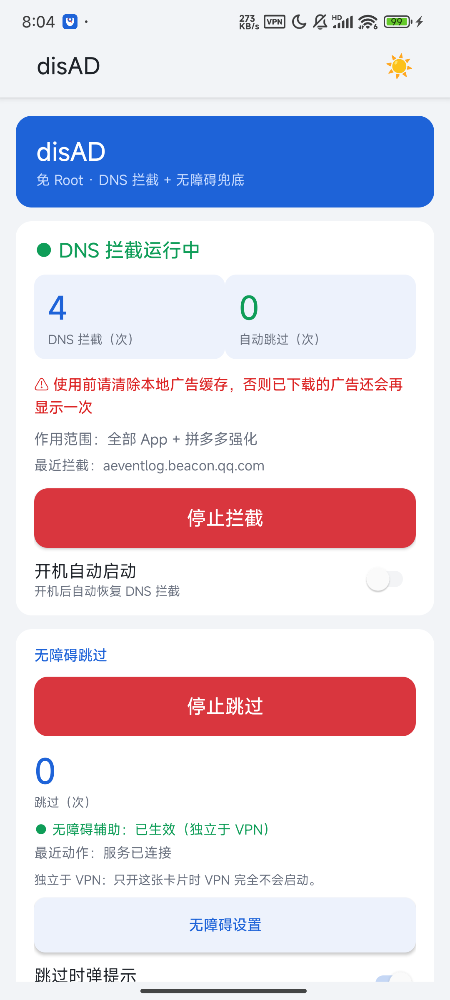
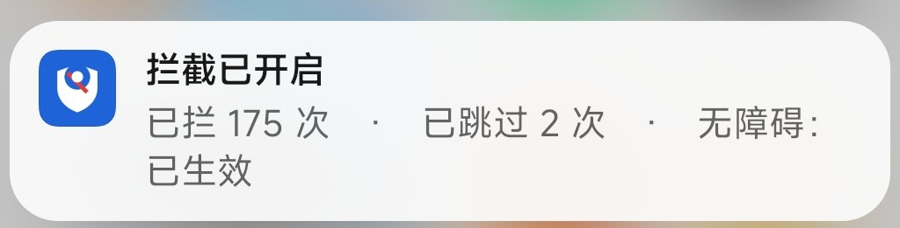
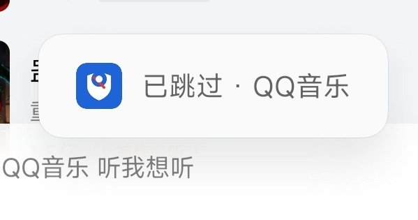
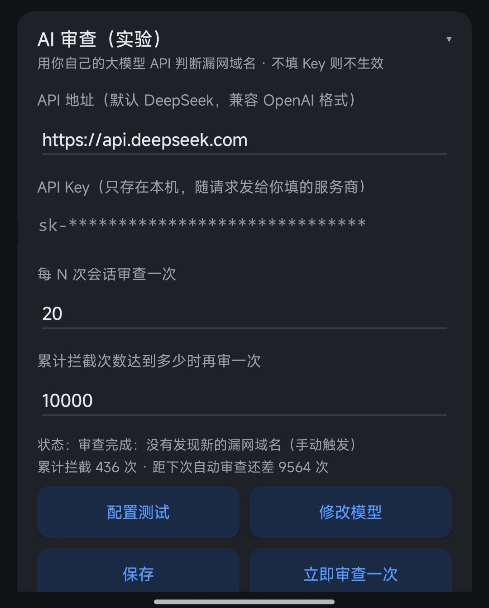

# disAD

**免 Root 的本地广告拦截 · Root-free local ad blocker**

`Android 8.0+` · `arm64` · `纯本地，广告域名不出本机` · `MIT` · `v2.6.1`

一个不依赖 root、不 hook、不修改任何第三方 App 的广告拦截工具。三层能力，各自独立开关：

1. **本地 DNS 过滤**（VpnService）—— 从网络层让广告 SDK 拿不到素材；
2. **无障碍辅助**（AccessibilityService）—— 在界面上点掉「跳过」；
3. **OCR 兜底**（实验）—— 无障碍读不到内容时，截图后本地识别「跳过」两个字。

> A root-free ad blocker for Android. No root, no hooking, no patching of other apps.
> Three independent layers: **local DNS filtering** (VpnService), **accessibility-assisted tapping**, and an optional **on-device OCR fallback** for screens that expose no accessibility nodes.

<p align="center">
  
  <br>
  <sub>DNS 拦截与无障碍跳过是两张独立卡片，各开各的，互不牵连</sub>
</p>

<p align="center">
  
  <br>
  <sub>两层都开时通知栏只留这一条，数字与主界面同源</sub>
</p>

---

## 两张卡片，各开各的

主界面没有「总开关」，只有两张互相独立的卡片：

| 卡片 | 点「启动」之后 | 点「停止」之后 |
|---|---|---|
| **DNS 拦截** | 起 VpnService，接管 53 端口 DNS | 隧道关闭，普通网络恢复 |
| **无障碍跳过** | 无障碍服务开始点「跳过」 | 立刻停止点击，撤掉通知 |

- 只开 DNS：只有网络层过滤；
- 只开无障碍：**VPN 完全不会启动**（适合开着加速器、或 App 一检测到 VPN 就拒绝服务的情况）；
- 两个都开：两层叠加，常驻通知**合并成一条**（`已拦 N 次 · 已跳过 N 次 · 无障碍：已生效`）。

<p align="center">
  
  <br>
  <sub>跳过一个广告时会弹一条短提示（可关）</sub>
</p>

---

## 它怎么工作

### 第一层：本地 DNS 过滤

- 用 `VpnService` 在本地起一个 DNS 转发器，**只接管 53 端口的 DNS 查询**，其它流量一个字节都不碰；
- 同时把手机当前网络使用的 DNS 服务器逐个挂上 `/32` 路由，App 换 DNS 也绕不开；
- 命中规则直接拒绝；没命中的原样转发给上游解析器，**不修改任何报文内容**；
- 上游不可用时返回 **SERVFAIL** 并设 1.2 秒超时 —— 让系统解析器快速失败并回落到下一个 DNS，而不是让 App 干等。

广告域名解析被拒绝后，广告 SDK 拿不到配置与素材，开屏广告往往根本不会被创建。

### 第二层：无障碍辅助点「跳过」

| 规则 | 条件 |
|---|---|
| 右上角文字 | 文字含「跳过 / 关闭广告 / skip」，长度 ≤ 8 字 |
| 跳过控件 id | `*:id/skip`、`*:id/skip_btn`、`*:id/tv_skip` 等 |
| 顶部条带文字 | 屏幕顶部 22% 以内，且确认有广告痕迹或像启动页 |
| 顶部条带精确匹配 | 文字正好等于关键词，不要求先看到广告痕迹 |
| 右下角条带文字 | 屏幕右下角，且确认有广告痕迹或像启动页（B 站这类） |
| 关闭控件 | 已在界面上确认是广告，才去找「关闭」按钮 / 关闭类 id |

约束：

- **不做任何屏幕坐标猜测**，所有点击都落在真实存在的控件上；
- 文字必须短（≤ 8 字）且只出现在顶部或右下角条带 —— 正文、聊天内容不会落进来；
- **不可见**（被遮挡 / 已滑出屏幕）的控件一律不点；
- 笔记、相册、文件管理、短信、联系人这类"文字就是用户内容"的 App 已被主动排除；
- 跳过成功可弹一条小提示（`已跳过 · 微信`），可在卡片里关掉。

> 早期版本还有一条「角落图形按钮」规则（点角落里任意可点击小控件），**已删除**：
> 它从未被证明成功过，却造成过"点进广告"。

### 第三层：OCR 兜底（实验，默认开）

有些界面在无障碍里**只有一两个节点**（微信小程序、纯图片开屏）—— 第二层读不到任何文字。这一层用截图找：

```
screenshot → 几何找"像按钮的小块" → 只对这些小块做本地文字识别 → 读到「跳过」才点
```

- 识别模型（PP-OCRv4 rec，10.4 MB）**打包在 App 内，不联网、不上传截图**；
- 只在无障碍规则全部落空时触发，每个窗口最多 2 次、间隔 ≥ 1.5 秒；
- 结果只用来决定"点不点"，截图不落盘；
- 系统截图限流（code=3）会自动重试一次；
- 功耗实测可忽略；不需要可在无障碍卡片里关掉。

---

## 功能

- **作用范围**（三个系别，独立开关）：百度系 · 其他（等于全局）· 拼多多系
- **额外作用 App 包名**：想只给某个 App 生效，填包名即可
- **状态与统计**：DNS 拦截次数（**本次打开以来**，每次进界面从 0 开始）、自动跳过次数、最近动作、最近拦截的域名；AI 卡里另有一个**落盘累计**的拦截数，两者口径分开
- **域名记录**：本机记录每一次域名查询（域名 / 次数 / 来源 App / 是否被拦），按启动会话分组，可查看 / 导出「近 N 次」
- **记录落盘**：拦截记录与累计数写进本地 `dnslog.tsv`（每 5 次拦截刷一次盘、退出时同步写），**彻底关掉 disAD 再打开，「近 N 次」和累计数都还在**
- **自动学习**：把「低出现率 + 自带广告特征词」的域名加入拦截。**内置基础设施保护列表**，腾讯 / B站 / 厂商 / 推送 SDK 等域名永不自动添加
- **导出自动学习名单**：攒到 ≥20 个时可一键导出（自带版本 / 时间 / 数量注释头）并发送邮件，用于完善公共规则库
- **夜间模式三态**：跟随系统 / 强制浅色 / 强制深色（右上角图标循环切换），弹窗与二级列表（域名记录、当前规则）一并对齐，不会出现白底浅字
- **AI 审查（可选）**：填自己的大模型 API（默认预设 DeepSeek），定期把**放行的域名**送给模型判断"哪些其实是广告/追踪"，结果只进「自动学习」名单，可一键撤销
- **查看当前规则**：只读展示当前生效的域名数、关键字规则数、作用范围（不提供导出）
- **规则自测**：输入任意域名，直接告诉你「会拦截（命中哪条规则）」还是「会放行」
- **自定义域名 / 白名单**：随时可加、可改、可回滚
- **拦截应用商店跳转**：广告拉起应用商店时不会真的跳过去
- **开机自动启动**
- **摇一摇广告指引**：这类广告靠运动传感器触发、不经过网络，三层都够不着 —— 但收回那个 App 的「运动与方向」权限即可让它失效

### AI 审查怎么触发

两道闸，任一满足就跑一次（**没填 API Key 时整块不生效**）：

1. **每 N 次会话**（默认 5，可改）；
2. **每累计拦截 N 次**（默认 10000，可改）—— 不是"只跨一次"，而是每再累计这么多就审一轮。累计数落盘、跨重启继续涨，不会每次开机清零。

界面上显示「累计拦截 N 次 · 距下次自动审查还差 M 次」，M 随每次拦截递减，可以自己核对。两道闸各自记账：会话触发不会把拦截基线顶回去。

两次审查之间至少间隔 10 分钟；开始 / 完成 / 失败各发一条通知。连接超时 20 秒 / 读取超时 120 秒（大模型回得慢），失败自动重试 1 次、之后静默，**绝不阻塞 DNS 路径**。

<p align="center">
  
  <br>
  <sub>填自己的 API，点「配置测试」自动拉模型列表并测连通性</sub>
</p>

---

## 权限说明

| 权限 | 用途 |
|---|---|
| `INTERNET` | 把放行的 DNS 查询转发给你配置的上游解析器；AI 审查开启时才额外请求你填的 API。**除此之外不发起任何网络连接** |
| `FOREGROUND_SERVICE` / `FOREGROUND_SERVICE_SPECIAL_USE` | 拦截需要常驻，前台服务 + 通知栏状态 |
| `POST_NOTIFICATIONS` | 显示拦截状态；无障碍被系统关闭时提醒你；AI 审查完成时提醒一次 |
| `RECEIVE_BOOT_COMPLETED` | 开机自动启动（可关） |
| `ACCESS_NETWORK_STATE` | 读取当前网络的 DNS 服务器地址 |
| `REQUEST_IGNORE_BATTERY_OPTIMIZATIONS` | 可选：加入电池白名单，避免后台被杀 |
| 无障碍服务（非普通权限） | 读取控件属性以点掉「跳过」；OCR 层需要 `canTakeScreenshot`。**不读取、不记录任何界面文字** |

没有申请：存储、位置、相机、麦克风、通讯录、`QUERY_ALL_PACKAGES`。

---

## 已知边界

**有些广告拦不住，原因不是规则写得不够多，而是它们绕开了这些手段。**

- **腾讯系**（微信 / QQ / QQ音乐等）：走自建 HTTPDNS（系统 DNS 看不到查询）+ 自研长连接与私有协议（根本不产生域名解析）+ 自营广告与业务同域。
  实测：一次微信会话 + 一个小程序 + 2~3 个广告，系统 DNS 只看到 21 个域名，其中真正的广告域名只有 1 个。
- **微信内的所有广告**：微信在前台时，无障碍树里只有 **1 个节点**（根节点，0 个子节点），遍历所有窗口结果一致 —— 第二层连"有没有『跳过』按钮"都无从得知。第三层（OCR）能看见画面，但小程序开屏广告的召回率仍在实测中。
- **TCP 版 DNS 不代理**：隧道只处理 UDP/53，发往被接管 DNS 地址的 TCP 查询会被丢弃（已计数并在日志提示）。少数强制 DoT/TCP 回退的场景可能解析失败。
- **摇一摇广告**：传感器触发，不经过网络。

**完整原理与实测数据 → [TECHNICAL.md](TECHNICAL.md)**

> 另注：App 会把广告素材缓存在本地，已经下载好的广告**断网也会再显示一次**。装上之后建议先清一次目标 App 的缓存。

---

## 构建

需要 **JDK 17** 和 **Android SDK 34**。

```bash
./gradlew assembleRelease          # 产出 app/build/outputs/apk/release/
```

Windows：`gradlew.bat assembleRelease`

**关于体积**：OCR 兜底需要 `onnxruntime-android`（1.22.0，约 18 MB，仅 arm64）+ 识别模型 `app/src/main/assets/ocr/rec.onnx`（10.4 MB），APK 因此约 28 MB。
不需要 OCR 的话，删掉 `app/build.gradle.kts` 里的 onnxruntime 依赖、`PillFind.kt` / `TextRec.kt` 与 `assets/ocr/`，再把 `SkipAdAccessibilityService` 里的 OCR 兜底分支删掉即可回到 1 MB 以内。

**16KB 页设备（Android 15+ 部分机型）**：`AGP 8.2` 只做 4KB 页对齐，必须再跑一次 `zipalign -P 16` 并重新签名，否则未压缩的 `.so` 在 16KB 页上无法加载。仓库里带了一键脚本：

```powershell
powershell -ExecutionPolicy Bypass -File tools\build-release.ps1
```

它会依次做：构建 → `zipalign -P 16` → 用 `local.properties` 里的 `DEV_STORE_*` 重新签名 → 校验（`zipalign -c -P 16` + `apksigner verify`）。

脚本有三处防坑设计（都是实际踩过的）：

- **优先用本机已装的 gradle**（`$env:GRADLE_BIN` 可指定），不用 `gradlew` 联网下载发行包；下载失败时会拿**上一次的旧产物**继续签名，产出看着成功、版本号却没变
- **签名前比对 APK 里的 versionName 与 `build.gradle.kts`**，不一致直接报错（gradle 会把未变化的任务标成 `UP-TO-DATE`，所以不能用文件时间判断新旧）
- **路径含中文时自动切到 ASCII junction 构建**（AGP 不接受非 ASCII 路径）

**在设备上验证 16KB / OCR 运行时**：仓库带了一个脚本，一次跑完"页大小 → 安装 → 抓日志 → 给结论"：

```powershell
powershell -ExecutionPolicy Bypass -File tools\verify-16k.ps1 -Apk .\dist\app-release-16k.apk
```

它会打印：设备页大小（4096 还是 16384）、是否出现 `dlopen failed / UnsatisfiedLinkError`、OCR 走的是 `xnnpack` 还是 `cpu`、模型加载与识别耗时，并把结果存到 `dist\verify-*.txt`。
### 16KB 页兼容性：验证记录

在 **Android 15 / API 35 / `PAGE_SIZE=16384`** 的模拟器（`sdk_gphone16k_x86_64`）上实测（2026-11-15）：

| 项目 | 结果 |
|---|---|
| APK 安装 | ✅ 成功（arm64 包与 x86_64 测试包均可安装） |
| `.so` 加载 | ✅ `Load .../libonnxruntime4j_jni.so ...: ok`，无 `dlopen failed / UnsatisfiedLinkError` |
| 执行提供者 | ✅ `OCR 就绪：6623 字符 / xnnpack / 6189ms`（XNNPACK 生效，未回退 CPU） |
| 模型冷启动 | 6189 ms（x86_64 模拟器 + 软件渲染，**不代表真机**） |
| 单次识别耗时 | ⏳ 待补（需要在真机上触发一次实际识别） |

静态校验（`aapt2` + `zipalign -c -P 16`）显示 `libonnxruntime.so` 与 `libonnxruntime4j_jni.so` 的
ELF `PT_LOAD` 对齐均为 `0x4000`，ZIP 内偏移亦满足 16 KB。
**签名**：仓库里**不含任何密钥**，所以 release 产出的是**未签名包**，请自行签名：

```bash
apksigner sign --ks your-release.jks app-release-unsigned.apk
```

**路径含中文时**：Android Gradle Plugin 不接受非 ASCII 路径，可先建一个 ASCII 路径的链接再构建（`gradle.properties` 里有具体命令）。

---

## 项目结构

```
app/src/main/java/com/kalvsupu/disad/
├── MainActivity.kt                    界面与交互
├── HelpText.kt                        使用说明文案（与界面分离）
├── Prefs.kt                           偏好读写、作用范围、升级迁移
├── SkipAdAccessibilityService.kt      第二层：无障碍辅助点「跳过」+ 第三层 OCR 兜底
├── PillFind.kt                        OCR 第三层：几何候选检测（纯图像算法）
├── TextRec.kt                         OCR 第三层：本地文字识别（onnxruntime + PP-OCRv4 rec）
├── ApiReview.kt                       AI 审查（用户自填 API）
├── AutoLearn.kt                       自动学习（含基础设施保护列表）
├── DnsLog.kt                          域名记录与候选打分
├── BlockStats.kt                      统计计数
├── CrashLog.kt                        崩溃堆栈落盘（本机，供用户复制反馈）
├── BootReceiver.kt                    开机自启
├── MarketInterceptActivity.kt         拦截应用商店跳转
├── DisAdApp.kt                        应用入口
├── dns/BlockList.kt                   规则匹配（标签前缀 / 精确 / 点分段）
├── dns/DnsMessage.kt                  DNS 报文解析
├── dns/UpstreamResolver.kt            上游转发
├── net/PacketUtil.kt                  IP/UDP 报文构造
└── vpn/AdBlockVpnService.kt           第一层：VpnService + DNS 拦截

app/src/main/assets/
├── blocklist_default.txt              内置规则（百度系 / 第三方广告平台 / 实测补充）
├── blocklist_strict.txt               更激进的通用广告端点（常驻）
├── blocklist_pdd.txt                  拼多多系素材域名（由开关控制）
└── ocr/                               rec.onnx + dict.txt（OCR 识别模型，本地）
```

规则引擎采用三级匹配（标签前缀 / 精确标签 / 点分段序列），目的是避免误伤：例如关键字 `gdtimg`（广点通图床）**不会**命中 `i.gtimg.cn`（QQ音乐图片 CDN）—— 差一个字母就能毁掉一个 App，这类边界靠实测反着验证。

---

## 隐私

- **没有任何统计、上报、埋点代码。** 网络出口只有两处：① 把放行的 DNS 查询转发给你设置的上游解析器；② 你**主动配置并开启** AI 审查时，向你自己填写的 API 地址发请求（未配置 Key 时完全不发）；
- 不采集任何数据，没有服务器，没有账号；
- **界面控件的文字内容永远不会出现在界面、通知栏或日志里** —— 代码里有白名单强制过滤，即使以后写错了也带不出去；
- OCR 的截图**不落盘、不上传**，用完即回收；识别模型在本地运行；
- **AI 审查只发送"放行的域名"**（一次最多 400 个），不发送截图、不发送 App 包名、不发送界面文字；
- 域名记录与累计数只写在 App 私有目录的 `dnslog.tsv`，随时可清空，不会上传；
- **「导出并发送」只在你点的那一下把名单交给系统邮件客户端**（收件人默认作者邮箱），发什么、发给谁，发送前你都能改；不点就什么都不会发；
- 全部代码与规则都在本地，可自行审计。

---

## 免责声明

1. 本软件是一个本地 DNS 过滤与无障碍辅助工具，**不修改任何第三方 App**，不破解、不修改会员权益，也不绕过任何付费内容；
2. 仅供个人学习与自用，请勿用于商业用途，请遵守你所在地区的法律法规；
3. 是否使用、如何使用由使用者自行决定，使用产生的一切后果由使用者自行承担。

## License

[MIT](LICENSE)

---

# English

**disAD** is a root-free ad blocker for Android 8.0+ with three independent layers.

**Layer 1 — local DNS filtering.** A local `VpnService` forwards DNS queries on port 53 only; every other packet is left untouched. It also installs `/32` routes for the DNS servers your network already uses, so apps cannot sidestep it by picking a different resolver. Blocked domains are refused; everything else is forwarded **byte-for-byte** to an upstream resolver you configure. When the upstream is unavailable it returns **SERVFAIL** with a 1.2 s timeout, so the system resolver fails fast instead of hanging.

**Layer 2 — accessibility-assisted tapping.** It only acts on short (≤ 8 chars) skip-like labels, known skip view-ids, and close controls when an ad is confirmed on screen. Constraints: **no screen-coordinate guessing**, invisible nodes are never touched, and apps whose on-screen text *is* user content (notes, gallery, files, SMS, contacts) are excluded.

**Layer 3 — on-device OCR fallback (experimental).** For screens that expose almost no accessibility nodes (WeChat mini-programs, pure-image splash screens), it takes one screenshot, finds button-like regions geometrically, and runs a bundled PP-OCRv4 recognition model **locally**. It only taps when it reads "跳过". The model ships with the app; screenshots are never saved or uploaded.

**Two independent cards.** Start DNS filtering and accessibility skipping separately — starting only accessibility never brings up a VPN. When both run, their notifications merge into one.

**Features.** Scope switches (Baidu family / everything else / Pinduoduo), per-app scope, live stats, on-device domain log, conservative auto-learning with a built-in infrastructure protection list, an optional AI review of *allowed* domains via a user-supplied API key (default preset: DeepSeek), read-only rule viewer, rule self-test, custom domains and whitelist, app-store jump interception, boot autostart, and guidance for sensor-triggered "shake" ads.

**Known limits.** Tencent apps (WeChat, QQ, QQ Music) use self-hosted HTTPDNS, proprietary long connections and same-domain first-party ads; inside WeChat the accessibility tree exposes a single node. Shake-to-jump ads are sensor-triggered and never touch the network. **Full analysis and measurements → [TECHNICAL.md](TECHNICAL.md)**

**Build.** JDK 17 + Android SDK 34: `./gradlew assembleRelease`. APK is ~28 MB because of the bundled OCR runtime and model (arm64 only); the README explains how to drop that layer and get back under 1 MB. The repository contains no signing key, so the release output is **unsigned** — sign it yourself. Android Gradle Plugin rejects non-ASCII project paths; see `gradle.properties` for a junction/symlink workaround.

**Privacy.** No analytics, no telemetry, no servers, no accounts. The only network activity is forwarding allowed DNS queries to your upstream resolver, plus an optional request to the API endpoint you configure yourself. On-screen text from other apps is never displayed, stored or logged — a hard-coded allow-list enforces this in code. OCR screenshots never leave memory. AI review sends only allowed domain names — no screenshots, no package names, no UI text.

**Disclaimer.** Provided for personal, educational use. It does not modify any third-party app, does not crack or bypass paid content, and comes with no warranty; you are responsible for how you use it.
